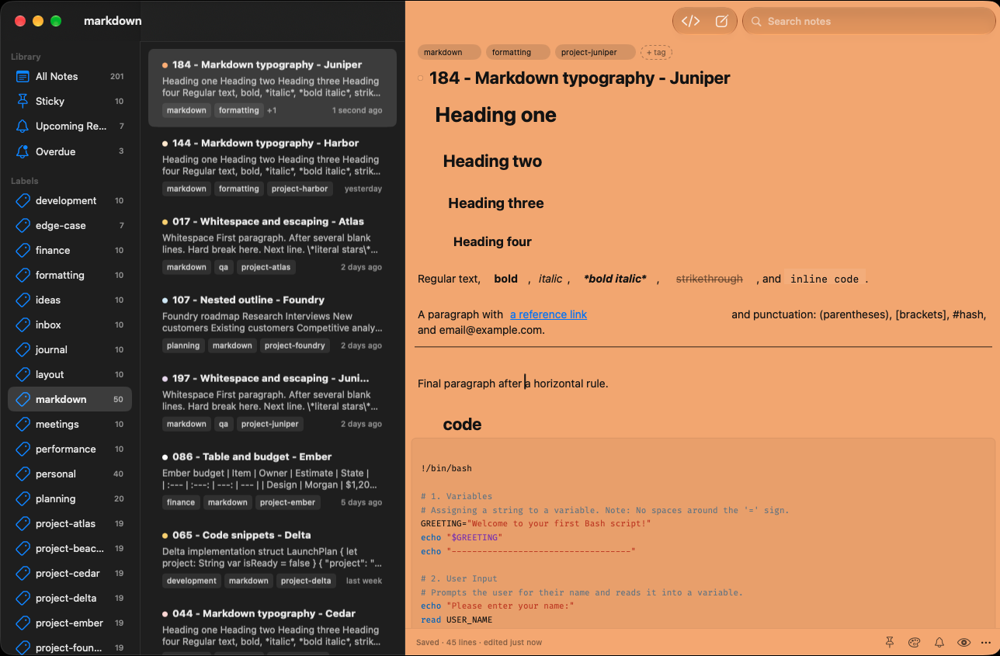
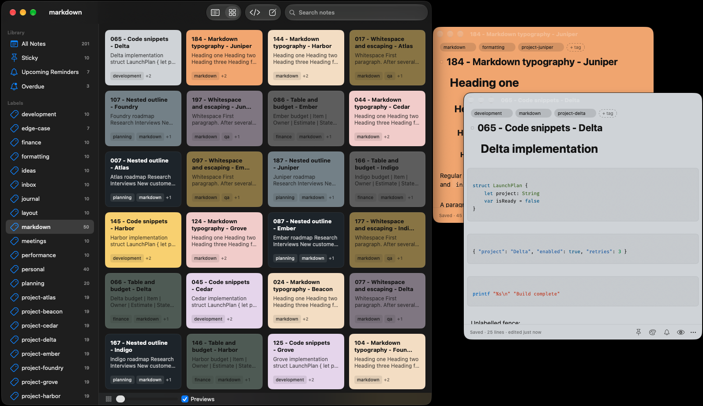
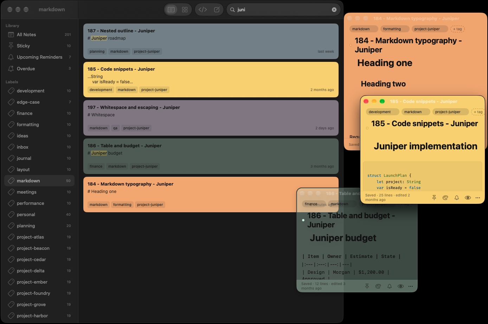
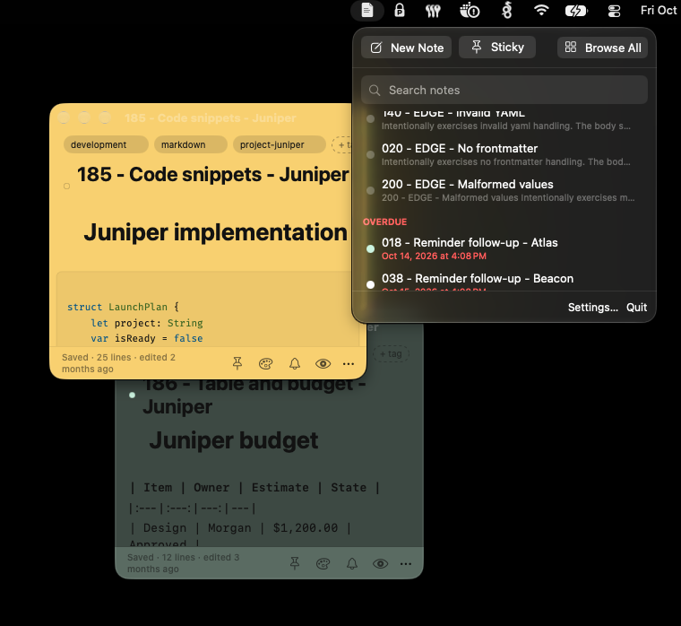

# NoteLume

Markdown notes for your Mac. Keep ideas in colorful, always-ready note windows,
or browse and edit everything from one searchable library. NoteLume requires
macOS 14 or later.

| Write and format Markdown | Browse notes as a board |
| --- | --- |
|  |  |
| Search and filter your notes | Create and revisit notes from the menu bar |
|  |  |

## Make Notes Your Own

- Write with live Markdown formatting, or switch to edit the Markdown source.
- Keep notes in separate windows, pin sticky notes above other windows, or use
	a single library with a selectable note list.
- Find notes by title or content, then organize them with labels and colors.
- Set reminders, browse note history, and recover notes from Trash.
- Create and reopen recent notes from the menu bar.

## Install

With [Homebrew](https://brew.sh/):

```bash
brew install --cask cybasoft/tap/notelume
```

Or download the signed, notarized disk image from
[GitHub Releases](https://github.com/cybasoft/notelume/releases), open it, and
drag NoteLume to Applications.

On first launch, choose the folder where you want to keep your notes. Each note
is stored there as a Markdown file. Changing the selected folder does not move
existing notes; copy or move those files yourself if you want to bring them to
the new folder.

For backup and recovery guidance, see [Backup and Recovery](docs/BACKUP_RECOVERY.md).

## License

The NoteLume community edition is free software under the
[GNU General Public License, version 3 only](LICENSE) (`GPL-3.0-only`). Your
notes and other user data are yours and are not licensed under GPL just because
you use NoteLume.

For contribution guidance, see [CONTRIBUTING.md](CONTRIBUTING.md). Developers
can find build, test, and release instructions in [docs/RELEASING.md](docs/RELEASING.md).
